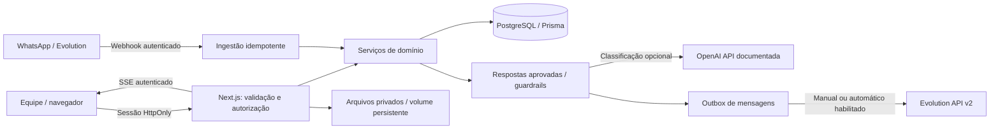

# Arquitetura e decisões

## Integridade

Telefone E.164 único. Webhook identifica evento pelo ID com namespace da instância; transação bloqueia por telefone, deduplica mensagem e registra primeiro contato exatamente uma vez. Índice parcial impede dois primeiros contatos por lead. `Lead.createdAt` mede aquisição; `Contact.createdAt` mede interações. Flags não substituem o critério de lead único. Contatos aqui são mensagens recebidas; se o escritório quiser medir sessões de atendimento, deverá definir intervalo de agrupamento e outra entidade.

Todas as entidades persistidas possuem UTC `timestamptz`; alterações de status, configuração, sessão, notas e envios geram auditoria. Atualizações de funil/responsável exigem `expectedUpdatedAt`, retornando HTTP 409 em edições concorrentes. O frontend oferece arraste e seleção de etapa como alternativa acessível.

## IA e confidencialidade

Texto do cliente é dado não confiável. Regras de intenção precedem FAQ e LLM; contrato, condições comerciais, prompts, credenciais e dados de outros clientes exigem humano. Prompt fixo não pode ser removido pelo prompt configurável. O LLM não tem ferramentas nem acesso ao banco: recebe somente histórico limitado daquele lead. Respostas livres do modelo nunca vão ao WhatsApp. FAQ aprovada pela equipe e mensagens de saudação/transferência são as únicas fontes de texto automático.

Configuração é restrita a ADMIN. A validação bloqueia padrões comerciais comuns e variáveis além de `{nome}`, mas a revisão humana continua obrigatória: um classificador por expressão regular não prova ausência de informação confidencial em um texto escrito por administrador. Dados internos/credenciais não devem ser incluídos em templates. Implementar governança e revisão de conteúdo antes de ampliar automação.

## Colaboração

Contas ADMIN/AGENT, senha com scrypt e sal aleatório, sessão com token aleatório de 256 bits (somente SHA-256 no banco), expiração de 8h, cookie HttpOnly/SameSite Strict/Secure em produção. Origem é verificada em mutações e login sofre limite persistido por email. Todos pertencem ao mesmo escritório. Agentes podem trabalhar leads, notas e mensagens; apenas administradores podem criar contas ou editar IA. Token interno de bootstrap é administrativo: mantenha-o fora do navegador de usuários comuns.

SSE verifica sessão, auditoria e presença a cada 2 segundos; duas sessões observam os mesmos dados do PostgreSQL. O navegador reconecta em falhas. Presença expira após 10 segundos sem heartbeat. Notas internas não são enviadas ao cliente. Stream revogado/expirado é fechado. Não há edição simultânea de texto, indicador de digitação ou múltiplos tenants. Para centenas de usuários, migrar o polling por conexão para Redis pub/sub, limitar conexões e ajustar reverse proxy/timeouts.

## Persistência e migrações

O runtime Prisma 7 usa adaptador PostgreSQL JS. O gerador sem binários chama pacotes **oficiais**, internos, fixados em 7.10.0; não desativa TLS/checksum. Essa API exige reverificação em upgrades. A CLI padrão precisa de `binaries.prisma.sh`, indisponível na política original. Migrações SQL revisadas são aplicadas por `scripts/migrate.mjs` com lock global, transação e SHA-256 em `_crm_migrations`. Não misture esse histórico com `prisma migrate deploy` sem uma tarefa de baseline. Nunca altere uma migração já aplicada: crie outra pasta.

PostgreSQL local usa volume Docker. Volumes e processos não devem ser presumidos presentes em outra máquina na nuvem. Faça backup/restore ou use PostgreSQL externo para preservar dados entre máquinas. Arquivos `MEDIA_DIR` precisam de volume e backup próprios; banco contém metadados, não bytes. Snapshots de código/dependências não provam restauração desses dados. Não publique cópias de credenciais ou dados de clientes.

## Desempenho e limites

Índices de criação, status+criação, histórico por lead e responsável. Métricas usam snapshot Repeatable Read e SQL parametrizado. Relatório agrega somente períodos solicitados, até 366 dias. CSV/PDF são limitados a 10.000 leads, sem truncamento silencioso; funil retorna 200 leads recentes, chat/notas 100 registros recentes. Exportações maiores e histórico completo exigem paginação/jobs assíncronos.

Outbox evita retransmissão automática de envios ambíguos. ACCEPTED significa aceitação do provedor; entrega/leitura ainda dependem de callbacks. Envios SENDING/UNKNOWN precisam de reconciliação humana. Autoenvio fica desabilitado por padrão, exige configuração e homologação. Esta versão não possui worker durável para retomar automação interrompida entre ingestão e geração da resposta; acrescentar worker, retries e reconciliação antes de produção.
